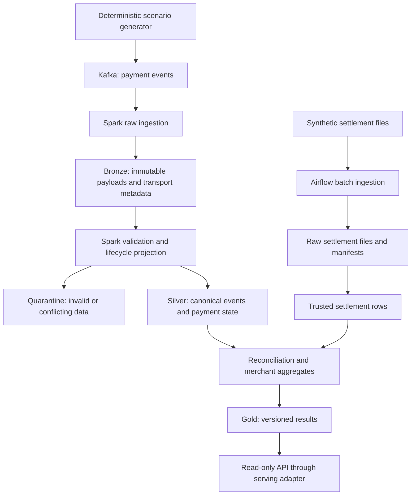

# PayFlow Integrity Platform

A payment event lakehouse for operational analytics and batch settlement reconciliation.

**Status: Phase 1 — design review.** This repository currently contains a project brief, proposed architecture decisions, draft data contracts, synthetic examples, and learning exercises. Kafka, Spark, Airflow, the API, and AWS infrastructure are planned; none is implemented or benchmarked yet.

## Business problem

A fictional payment processor receives authorizations, captures, and refunds through an event feed. Operations needs current payment metrics; finance needs to identify differences between those events and daily settlement files. Duplicate delivery, delayed events, missing versions, and batch retries must not silently change financial totals.

The initial product will answer:

- What is the last complete, valid lifecycle state of a payment?
- What captured and refunded amounts were observed for each merchant?
- Which settlement operations are missing, unexpected, duplicated, or mismatched?
- How fresh and complete is the data behind each answer?

All examples are fictional. The project does not connect to payment networks or handle real funds, card details, or customer records.

## Proposed architecture



Raw, trusted, and enriched lakehouse layers will use one table format. Delta Lake versus Iceberg, query serving, and the exact AWS services remain open decisions. See [architecture](docs/architecture.md) for consistency boundaries, recovery, and security proposals.

## Start here

1. Read the [project brief](docs/project-brief.md).
2. Review [ADR 0001: authority and rebuildable state](docs/decisions/0001-authority-and-projections.md).
3. Work through the [Phase 1 exercise](docs/phase-1-workshop.md).
4. Inspect the [draft contract](contracts/README.md) and [synthetic scenario](examples/happy-path.json).
5. Review [ADR 0002: event identity and ordering](docs/decisions/0002-identity-and-ordering.md).

## Roadmap and evidence

The [roadmap](docs/roadmap.md) uses demonstrable exit criteria. The [Interview Story](docs/interview-story.md) distinguishes design reasoning from implemented and tested evidence. ADRs remain **Proposed** until the project owner reviews them.

## Local development

There is no runtime or Docker Compose stack yet. To inspect this design snapshot:

```sh
git clone https://github.com/aayushga/payflow-integrity-platform.git
cd payflow-integrity-platform
```

No cloud account, paid dataset, or credentials are required for Phase 1. Docker, dependency versions, test commands, and resource requirements will be documented when the first executable slice exists.

## Reliability and scope

The proposed model combines at-least-once ingestion with explicit business identities, conflict detection, rebuildable projections, and versioned reconciliation runs. End-to-end exactly-once behavior is not claimed. Initial scope is one synthetic provider, USD integer cents, one full capture per payment, and at most one full refund. See the [brief](docs/project-brief.md) for boundaries and [contracts](contracts/README.md) for proposed invariants.

AWS deployment, CI/CD, observability, benchmarks, and optional AI investigation are later phases. No throughput, availability, compliance certification, or production deployment claims have been established.
